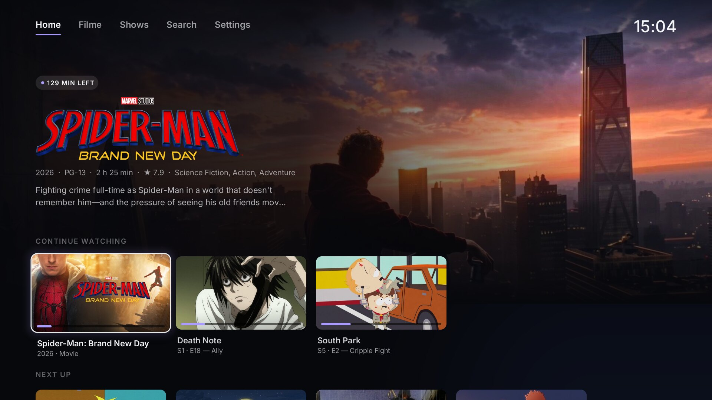
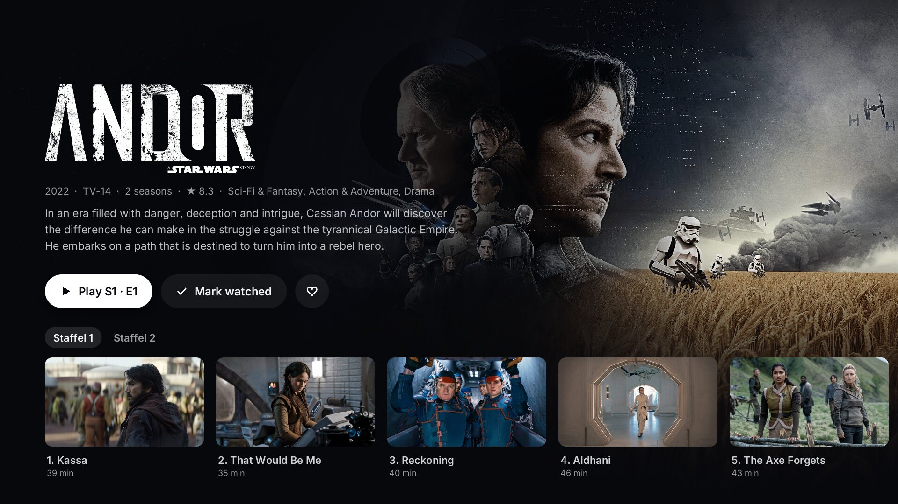
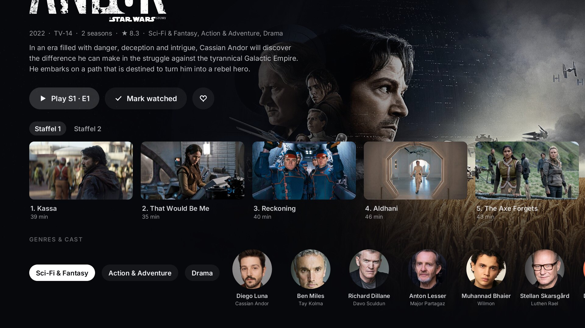
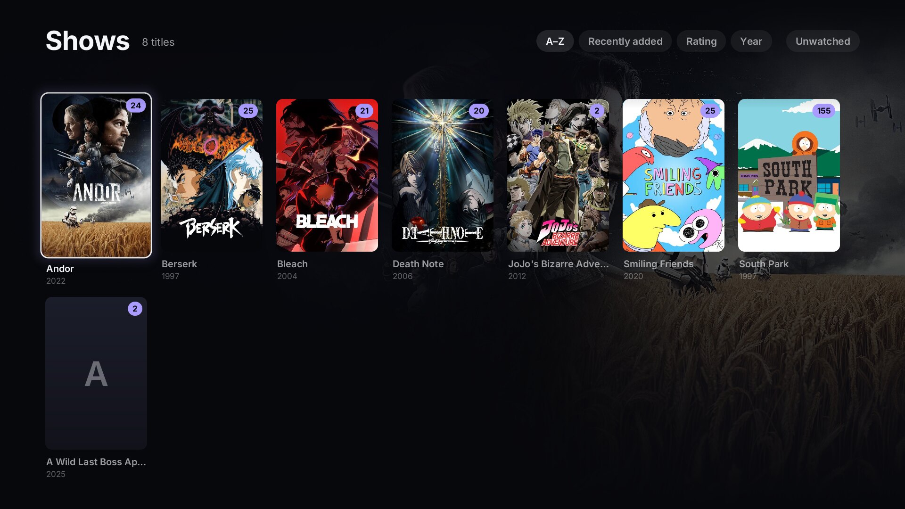
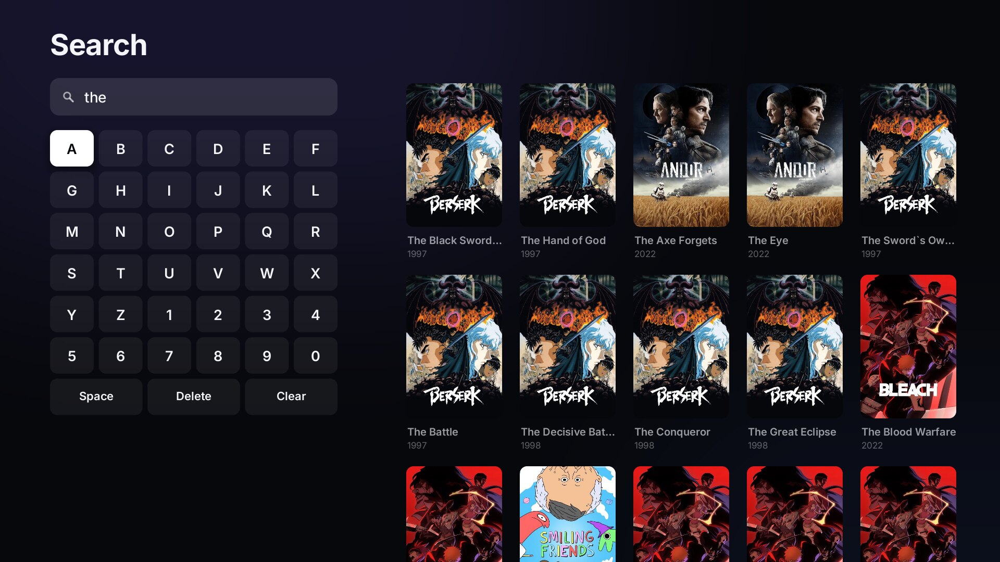

# Jellyfin Native (webOS)

A native Jellyfin client for LG webOS TVs, written in Rust. No browser and no WebView: the UI is drawn
with GLES2 on the TV's GPU, and video is decoded by the TV's own media pipeline. It is styled to match
**[Minimal Home](https://github.com/SchulzCode/WebOS-Minimal-Launcher)**, its companion launcher (same palette, Inter, cards, focus rings) and installs as its own app,
`tld.my.jfnative` ("Jellyfin Native"), next to the official Jellyfin app if you have it.

Unofficial and not affiliated with the Jellyfin project or LG. Tested on one TV, see [Tested on](#tested-on).



| | |
|---|---|
|  |  |
|  |  |

## Tested on

Developed and tested on one TV; other models are untested. If it works (or doesn't) on yours, please open an issue.

| | |
|---|---|
| TV | LG OLED55B4ELA (OLED B4, 2024, EU) |
| Firmware | 33.31.75 |
| webOS | webOS TV 25 (webOS 10.3.2, board K24) |
| Root / homebrew | rooted, Homebrew Channel 0.7.3, SSH on |
| Jellyfin server | 12.2.0 |

## Install

You need an LG webOS TV with the [Homebrew Channel](https://github.com/webosbrew/webos-homebrew-channel) (developer
mode or a rooted TV).

1. Download `tld.my.jfnative_<version>_arm.ipk` from the [Releases page](https://github.com/SchulzCode/WebOS-Jellyfin-Native/releases).
2. Install it, e.g. with `ares-install tld.my.jfnative_<version>_arm.ipk` (webOS CLI) or the Homebrew Channel.
3. Start "Jellyfin Native". It looks for Jellyfin servers on your network; pick yours or type its address, then
   approve the Quick Connect code from any signed-in Jellyfin app (profile → Quick Connect). Quick Connect must be
   enabled on the server (Dashboard → General).

Finding the server uses Jellyfin's auto-discovery (UDP port 7359). A server in Docker usually only answers with host networking
(broadcasts rarely make it through a published port), and discovery doesn't cross VLANs; behind a reverse proxy, set the address the server should
announce under Dashboard → Networking → "Published server URIs". Otherwise just type the address; the app remembers
it for the next sign-in.

## Privacy and security

- No password is ever entered or stored: sign-in is Quick Connect only. The access token is kept in
  `/media/developer/jfnative/session.json`, readable by the app's own user only (the folder is `0700`); signing out
  in Settings deletes it.
- The app talks only to your Jellyfin server and, if you run it, the optional [server helper](#server-helper-optional)
  on the same host (port 8091). No analytics, no third-party requests. HTTPS certificates are verified
  (self-signed certificates are not accepted); plain `http://` works for servers on your LAN.
- Deleting a title is the only time the app's Jellyfin sign-in leaves for anything but Jellyfin: it goes to the server
  helper, which checks it with Jellyfin. The helper speaks plain HTTP on your LAN.
- Release builds contain no developer hooks. Crash dumps are disabled (`RLIMIT_CORE=0`), so a crash can't fill
  the TV's app storage.
- The log `/tmp/jfnative.log` (the previous run: `/tmp/jfnative.log.1`; cleared at every TV boot) is readable by the app only.

## What it does

- **Sign-in with Quick Connect**: a code on the TV, approved in any signed-in Jellyfin client. The session
  is stored in `/media/developer/jfnative/session.json` (outside the app folder, so it survives reinstalls).
- **Home**: hero backdrop + logo of the focused title, tabs (Home, each library, Search, Settings), and rows
  for Continue watching, Next up, Downloading, Recently added per library, and Your libraries.
- **Downloading** (needs the [server helper](#server-helper-optional)): what Sonarr and Radarr are fetching right now,
  with progress and time left that count down live. The artwork is greyed out and fills with colour from the left as
  the download progresses, with an arrow dropping into a tray; focused, the download becomes the hero (greyed fanart,
  logo, status, overview). A season pack is one card; queued, paused, stalled and problem downloads say so. Refreshed
  every 15 s while something downloads. Settings → "Show what's downloading" switches the row off.
- **Libraries**: poster grid with A–Z / Recently added / Rating / Year sorting and an **Unwatched** filter, loaded page by page.
- **Detail pages**: logo or title, metadata ("Ends at 21:01"), technical line (resolution, codec, audio,
  subtitle languages), Resume / From the start / Mark watched / Favourite. Shows get season tabs and an
  episode row. Films get "More like this". A **Genres & cast** row at the bottom opens a grid of every film/show of
  that genre or with that person. Items with several versions get a version button.
- **Delete** (needs the [server helper](#server-helper-optional) with deleting switched on): films and whole series get
  a trash button for Jellyfin administrators. The confirmation names the title exactly as Sonarr/Radarr will delete it,
  what goes (seasons, episode files, size) and the free space before and after, with the freed part marked on the disk
  bar; Cancel is focused first. The delete goes through Sonarr/Radarr (files included, and they stop downloading it),
  then the title disappears from Home, the libraries and search right away.
- **Search**: an on-screen keyboard that works with the plain remote, with live results.
- **Player**:
  - Direct play of H.264 / HEVC / VP9 / AV1. AAC / AC3 / E-AC3 / DTS go to the TV's decoder as they are.
  - TrueHD, FLAC, ALAC, Opus, Vorbis, PCM and other audio the TV's decoder doesn't take is decoded **on the
    TV** with its own libavcodec and re-encoded to AC3 (5.1 at 640 kb/s, 7.1 folded into 5.1; stereo at
    256 kb/s), which the hardware plays natively. The server never converts audio. LG's BUFFERSTREAM only
    accepts PCM as 16-bit stereo (libpf's `LUT_ChannelModeType`/`LUT_BPSType`), so AC3 is how surround survives.
    Measured: TrueHD 5.1 costs the engine thread ~11 % of one core (vs ~5 % for native audio).
  - Matroska font attachments (anime releases carry 100+ fonts, tens of MB) are never downloaded: their byte
    range is served to FFmpeg as one EBML Void element (`player/source.rs`). That took a 41 MB-font file from
    5.6 s to 1.5 s to first picture.
  - If the TV refuses a file, it retries once with full server conversion.
  - OSD with a progress bar, "ends at", and an accumulating skip (10 s → 30 s → 60 s steps while held).
  - Audio and subtitle menu (▲).
  - Text subtitles: embedded SRT/ASS/WebVTT are **demuxed on the TV** from the stream (all tracks at once, instant
    switching, ASS tags stripped locally); external files and server conversions use the server's SRT.
  - **Exact seeking**: when the keyframe is more than 2.5 s before the target, the pipeline decodes through and
    shows frames only from the target (`ptsToDecode`, ~0.1 s per second skipped). Seeks are in place (same
    connection and demuxer, new LG pipeline): ~0.65 s.
  - **Chapters** (from the server): CH+/CH− jump, listed in the ▲ menu, marked on the progress bar.
  - **Trickplay** thumbnails above the seek time when the server has generated them.
  - **Track memory**: audio/subtitle picks are remembered per series by language/title (`tracks.json`) and
    carry over to the next episode; otherwise the server's defaults, which follow the Jellyfin account settings.
  - **OLED care**: own idle screen (true black + a dim clock that moves every minute) after 2 min without input in the
    menus or 3 min paused; a playing video never counts as idle. 20 minutes later the app closes. Minimal Home's helper
    turns LG's screensaver off while the app is in front, so there is only one.
  - **Pointer**: the control row (−10 s, play/pause, +10 s, tracks, chapter), the progress bar (click = seek),
    skip intro, up next and the track menu are clickable.
  - **Image subtitles (PGS/DVD), decoded on the TV** with its own libavcodec. No server burn-in.
  - **Bluetooth lip sync**: while the TV's sound goes to Bluetooth headphones (detected from LG's `btaudiosrc`), audio
    is played slightly earlier than the picture (default 25 ms; ▲ menu → "Bluetooth lip sync", ◀ ▶ in 25 ms steps).
    Connecting or disconnecting mid-film is picked up within ~3 s.
  - Skip intro/recap (Jellyfin media segments), and Up next with a 10 s countdown and autoplay. The queue is the rest of the
    series across seasons, however the episode was started (detail page, Continue watching, search, a launcher card).
  - Progress reported to Jellyfin (start / every 10 s / pause / stop), so Continue watching stays
    right everywhere, including Minimal Home.
  - The Home key releases the decoder at once; coming back resumes at the same spot.
- **Settings**: subtitle size, subtitles (as in the Jellyfin account / off), audio language, remember choices per
  series, autoplay, the technical-info overlay, the Downloading row, and sign out (stored in
  `/media/developer/jfnative/prefs.json`). With the server helper, it also shows the **media storage**: free space,
  used/total and a bar per disk (red above 90 %).
- **Launch parameters**: `{"itemId": "<id>", "play": true}` plays an item directly (or omit `play` to open
  its page). This is meant for a launcher card. The item's page sits under the player, so Back goes player -> item ->
  Home -> launcher, as if it had been started inside the app.

Measured on the TV: UI ready **0.3 s** after launch; first picture **1.0–2.0 s** after pressing play for direct
play, including audio re-encoded on the TV; a skip shows the new picture after ~1.1 s. While playing
without the OSD, the app's own threads use ~5 % of one core (the rest is LG's decoder threads), with ~36 MB
resident. When nothing moves, nothing is drawn; while something animates, frames are paced by hand to 60 fps
(the swap doesn't block on this compositor and `SDL_WaitEventTimeout` oversleeps). Menus run at a steady 60 fps
with ~2 ms of CPU per frame. The GPU (~12–15 ms per 1080p frame) is the real limit, so the full-screen colour washes
and backdrop gradients are baked into small textures instead of being drawn as blurred shapes.

Images are decoded on the TV with the `image` crate; baseline JPEGs that store each colour in its own scan (Sonarr and
Radarr write their resized artwork like that) go to `jpeg-decoder` instead, because `image`'s zune-jpeg turns them
into green stripes.

Remote keys: LG's SDL delivers the remote's buttons as scancode 1 with the real code in `sym`
(arrows 79–82, OK 40, Back 482, …); `ui::map_key` handles both that and normal keyboards.

## Server helper (optional)

The Downloading row, the media storage panel and deleting come from a small service that runs next to Sonarr and
Radarr: `server/launcher-feed` in [Minimal Home](https://github.com/SchulzCode/WebOS-Minimal-Launcher) (one Docker
container; setup and details in its README). The TV never holds the Sonarr/Radarr API keys - the service has them.

- The app looks for it at `http://<Jellyfin host>:8091`; set `"feed_url": "http://<host>:8091"` in
  `/media/developer/jfnative/prefs.json` if it runs elsewhere. Without it nothing extra appears, and the app asks again
  only every 5 minutes.
- Deleting is off unless the service runs with `ALLOW_DELETE=1`; the trash button only appears when the service says
  it is on and Jellyfin says you may delete. The service acts only for Jellyfin administrators (it checks the app's
  sign-in with Jellyfin) and deletes only the Sonarr/Radarr entry the confirmation showed.

## How playback works

```
Jellyfin HTTPS ─▶ player/source.rs (range requests, rustls)
              ─▶ TV's libavformat 5.0 via custom AVIO (Matroska/MP4 demux) + h264/hevc_mp4toannexb, ADTS for AAC
              ─▶ src/native/smp.c ─▶ LG StarfishMediaAPIs "BUFFERSTREAM" (libplayerAPIs) ─▶ hardware decoder
              ─▶ picture on an SDL "exported window" (video plane) under our transparent GLES surface
```

- The C shim calls LG's C++ class through its mangled symbols (no LG headers or C++ runtime needed). The
  object is constructed in place, Feed's `std::string` return is handled by hand, and Load uses the
  callback-with-context overload.
- The Load payload declares a sink envelope per codec. On webOS 10 the pipeline allocates against the
  *declared* maximum, and H.264 at full size only goes to 30 fps, so H.264 ≤1080p declares 1080p at its
  own rate class and HEVC declares 4K60. (Found by plx-native's webOS 10 lab report; this TV's
  `/etc/umediaserver/device_codec_capability_config.json` agrees.)
- A seek is a fresh session at the new position. The pipeline's in-place seek needs private struct offsets
  on this firmware, and a reload takes ~1 s and always works.
- References that made this possible: Kodi's `MediaPipelineWebOS.cpp`, plx-native's `src/starfish.c` and
  docs (GPL; read, not copied), and webosbrew's `webos-userland` headers (event enum, SDL webOS calls).
  The exports were checked on this TV's libraries with `readelf`/`nm` (`scripts/fetch-sysroot.sh` copies them).

## Build and install

Requirements on the PC (x86_64 Linux is fine; no LG SDK needed):
- Rust with the `armv7-unknown-linux-gnueabi` target (the TV is 32-bit ARMv7 with the **soft-float** ABI, glibc 2.35)
- Zig 0.14 in `~/.local/share/zig/current`, plus `cargo install cargo-zigbuild`
- `ares-package` (`npm i -g @webos-tools/cli`)
- a rooted TV with SSH enabled (Homebrew Channel settings) - the build links against the TV's own libraries, which
  are LG's and can't be shipped in this repo

```sh
cp config.example.env config.env   # TV address and SSH key (git-ignored)
scripts/fetch-sysroot.sh           # once: copy the TV's libraries to link against into sysroot/ (never commit them)
scripts/gen-bindings.sh            # only if the TV's FFmpeg changes (src/sys/ff.rs is committed)
RELEASE=1 scripts/package.sh       # build + package build/out/*.ipk for publishing (nothing personal baked in)
scripts/deploy.sh                  # package + install on the TV through the Homebrew Channel
```

`JFNATIVE_SERVER=https://…` in `config.env` makes your own builds suggest your server on the sign-in screen; nothing
is baked in by default.

Development helpers (only in `DEV=1 scripts/deploy.sh` builds, never in releases):
- `scripts/shot out.png [w h]` captures the TV screen (the UI; video isn't captured).
- `scripts/keys "D R OK"` plays remote presses into the running app while `/media/developer/jfnative/dev-keys-enabled`
  exists. Keys: `U D L R OK B PLAY PAUSE FF RW STOP INFO CHU CHD`, single lowercase letters, `click:x:y` / `move:x:y`.
- The log is `/tmp/jfnative.log` on the TV (previous run: `.log.1`). It records frame timing every 2 s while drawing (`fps …`) and any
  iteration over 60 ms (`slow: …`). Creating `/media/developer/jfnative/gpu-timing` adds a `glFinish` so "submit" shows GPU time.

## Layout

| path | what |
|---|---|
| `src/app.rs` | main loop (event-driven), screen stack, input, lifecycle, prefs, launch params |
| `src/ui/` | screens: `connect`, `home`, `library`, `detail`, `search`, `settings`, `player_ui`; widgets/icons in `mod.rs` |
| `src/gfx/` | GLES2 renderer (SDF rounded rects, shadows, rings, gradients, images), text (fontdue + atlas), image cache |
| `src/player/` | `engine.rs` (demux → pipeline, image-subtitle decoding), `audio.rs` (decode + AC3 re-encode on the TV), `source.rs` (HTTP, attachment skipping), `mod.rs` (sessions, video plane) |
| `src/native/smp.c` | the C seam to LG's StarfishMediaAPIs and the exported video window |
| `src/jf.rs` | Jellyfin API + models |
| `src/feed.rs` | the optional server helper: downloads, media storage, delete; download cards/hero in `ui/downloads.rs` |
| `src/sys/` | SDL/FFmpeg/shim bindings |
| `assets/fonts/` | Inter 4.1 (OFL), subset to Latin/Greek/Cyrillic; Japanese etc. comes from the TV's own fonts |

## Licenses

The code is [0BSD](LICENSE): do anything you like with it, no attribution needed. The film and series artwork in the screenshots (`docs/screenshots/`) belongs to its rights holders and is only shown to illustrate the app.

Jellyfin Native links dynamically against the TV's own SDL2, FFmpeg (LGPL) and LG libraries at runtime; none of them
are included. `assets/fonts/` is Inter (SIL Open Font License, see `assets/fonts/LICENSE.txt`).

## Known gaps

- The Magic Remote pointer was tested with injected events (`scripts/keys "click:x:y"`), not the physical remote.
- Errors: unreachable server → Home says so and retries every 15 s (OK retries now); the player offers OK = try
  again; a rejected token (HTTP 401) sends the app back to sign-in.
- No Dolby Vision metadata or Atmos declaration yet (HDR10/HLG direct play should work but is untested).
- Image subtitles are not available while the server converts the stream. That now only happens as the
  fallback when the TV refuses the video.
- One user per sign-in (no profile picker).
